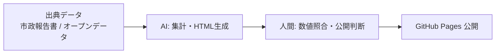

# secret-base

個人制作の実験プロジェクトです。1990年代の個人ホームページ文化を再現した管理人ページと、磐田市のオープンデータ分析ページで構成されています。

公開サイト: https://kaopuuu-hash.github.io/secret-base/

- index.html：管理人ページ（トップ）
- kessan.html：磐田市 令和7年度決算まとめ
- analysis.html：財政分析
- dashboard.html：磐田市オープンデータ ダッシュボード
- method.html：分析手法
- sources.html：出典・参考資料
- seisaku.html：制作手法・このサイトについて（注記）
- fukuroi.html：袋井市オープンデータ ダッシュボード
- mori.html：森町オープンデータ ダッシュボード
- kakegawa.html：掛川市オープンデータ ダッシュボード
- showcase.html：Web Tech Showcase 2026（技術デモ集）
- qc-tool.html：QC Analysis Tool v2（品質管理分析ツール）
- teigen.html：日本の製造業を立て直す — 現場で働く一人の労働者からの提言
- hdbe.html：尊厳境界倫理モデル（HDBE）— 人間の尊厳を護る実践的倫理体系
- lab/：静岡の気候 1940-2025 分析・公共施設アクセス分析
- akiya/：磐田市 空き家・地域住宅ストック統合分析（8画面ダッシュボード）
- data.html：地域データ置き場（真面目な紹介用の入口・幾何学デザイン）

最終更新：2026年11月6日

## 証明（このサイトの作り方）

### 技術スタック

- 静的HTML（単一ファイル構成）＋埋め込みCSS。原則 JavaScript なし、外部読み込み・広告・解析なし
- 例外：Dashboard系ページは Tailwind / Chart.js（CDN）を使用
- 公開：GitHub Pages

### アーキテクチャ

### データの出典

- 磐田市「令和7年度 市政報告書」（決算数値の原典）
- 磐田市オープンデータ（LinkData）
- 磐田市公式ウェブサイト https://www.city.iwata.shizuoka.jp/
- 袋井市公式ウェブサイト（人口表 Excel／避難所 PDF）
- 森町公式ウェブサイト（人口統計表 PDF／避難所 PDF）
- 掛川市公式ウェブサイト（オープンデータ）
- 総務省 住宅・土地統計調査（e-Stat）／国土交通省 PLATEAU 3D都市モデル（空き家分析の原典）

### 計算式

- 実質収支 ＝ 貯金（基金）の切り崩し分を除いた収支
- 高齢化率 ＝ 65歳以上人口 ÷ 総人口 × 100
- 総人口・総世帯数 ＝ 町別データ299件の合計
- 財政指標（財政力指数・経常収支比率・実質公債費比率・将来負担比率）は市政報告書 第3表・第12表からの引用（独自計算ではない）

### 更新日

2026年11月6日

### AIが担った工程と、人間が止めた箇所

- AI：データ整理、集計補助、HTML作成、リンクの整合性チェック
- 人間：数値の最終照合、公開前の個人情報チェック、全変更のマージ判断（AIは勝手に公開しない）
